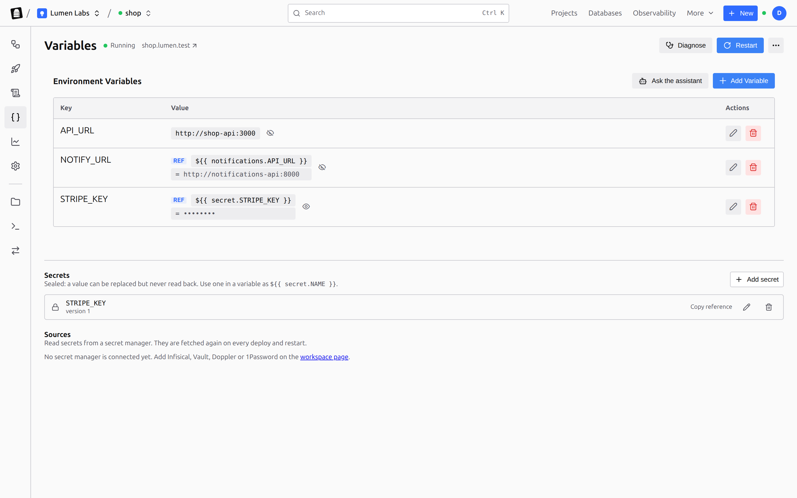
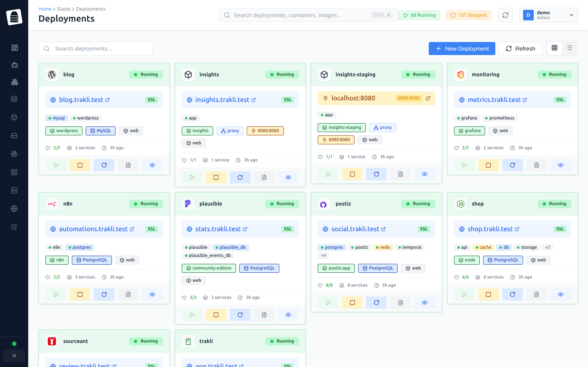
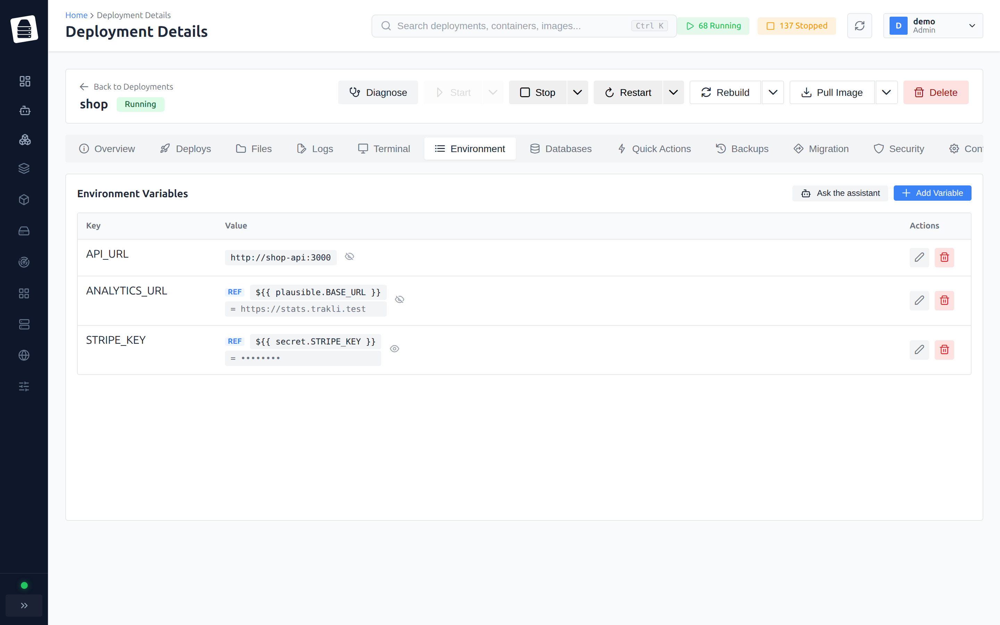

<p align="center">
  <a href="https://flatrun.dev">
    <picture>
      <source media="(prefers-color-scheme: dark)" srcset="https://flatrun.dev/flatrun-logo-white.svg">
      
    </picture>
  </a>
</p>

**Open source, self-hosted alternative to Railway and Render.** Deploy Docker Compose projects on your own servers.

FlatRun brings the Railway workflow to a server you control: projects made of services, environments, deployments you can roll back, variables shared between projects, and templates for common apps. Each project is a directory with a standard Compose file, so it keeps running under plain `docker compose` if you stop using FlatRun.

This repository is the **control panel**: the web UI for FlatRun, a Vue app that runs on top of the [agent](https://github.com/flatrun/agent) API.

<picture>
  <source media="(prefers-color-scheme: dark)" srcset="docs/screenshots/projects-canvas-dark.png">
  
</picture>

Every project is a card on one canvas, with its domain, whether it is online, and the services inside it. An arrow means one project reads a variable from another. Cards and table views are one click away, and the choice is remembered.

## Inside a project

Opening a project shows its services as a graph, drawn from the Compose file: what depends on what, which domain points where, how many replicas are up, and which folder each one stores its data in. The rail on the left holds deployments, logs, variables, metrics, settings, files and a terminal. **Add** opens the place where a new service, database, domain or volume is set up.

<picture>
  <source media="(prefers-color-scheme: dark)" srcset="docs/screenshots/project-architecture-dark.png">
  
</picture>

## Variables, references and secrets

A variable can point at another project's variable with `${{ plausible.BASE_URL }}`, and the page shows what it resolves to. Secrets are sealed: they can be replaced or rotated but never read back, and are used as `${{ secret.NAME }}`. Secrets can also come from Infisical, HashiCorp Vault or OpenBao, Doppler, or 1Password Connect, fetched again on every deploy.

<picture>
  <source media="(prefers-color-scheme: dark)" srcset="docs/screenshots/project-variables-dark.png">
  
</picture>

## Layouts

Everything above uses **Birch**, the default: a top bar, the workspace switcher, and projects on a canvas. **Oak** keeps a sidebar and the full set of operator screens. Switch between them from the user menu.

<table>
  <tr>
    <th>Birch</th>
    <th>Oak</th>
  </tr>
  <tr>
    <td>
      <picture>
        <source media="(prefers-color-scheme: dark)" srcset="docs/screenshots/projects-canvas-dark.png">
        
      </picture>
    </td>
    <td>
      <picture>
        <source media="(prefers-color-scheme: dark)" srcset="docs/screenshots/oak-deployments-dark.png">
        
      </picture>
    </td>
  </tr>
  <tr>
    <td>
      <picture>
        <source media="(prefers-color-scheme: dark)" srcset="docs/screenshots/project-variables-dark.png">
        
      </picture>
    </td>
    <td>
      <picture>
        <source media="(prefers-color-scheme: dark)" srcset="docs/screenshots/oak-variables-dark.png">
        
      </picture>
    </td>
  </tr>
</table>

Layouts are named after trees, so the next one has a name waiting.

## Features

- **Projects on a canvas**: projects, their services and the links between them, in canvas, card and table views
- **Workspaces**: teams with owners, admins and members, invitations, and projects that belong to a workspace
- **Environments**: staging and preview copies of a project, switched from the canvas
- **Deploy history**: each deploy with its commit, phase and logs, plus redeploy and rollback
- **Variables and secrets**: references between projects, sealed secrets with rotation, and external secret managers
- **Live logs**: streaming logs with search and filtering
- **Monitoring**: container status, resource usage, health checks, and CPU, memory and disk on the host
- **Docker resources**: images, volumes and networks
- **SSL certificates**: expiry and status for every domain
- **Templates**: deploy common applications from ready-made templates
- **Fleet management**: connect servers, scope peer access, and open each server's projects from one dashboard
- **Managed scaling**: configure compatible workloads and activate Docker Swarm or k3s scaling
- **Notifications**: grouped incidents and delivery rules for email, webhooks and custom targets
- **Files**: upload folders, copy or move files, browse archives and extract them in place

## Tech Stack

- **Framework:** Vue 3 with Composition API
- **Language:** TypeScript
- **Build Tool:** Vite
- **State Management:** Pinia
- **Routing:** Vue Router
- **UI Components:** PrimeVue
- **HTTP Client:** Axios

## Development

### Prerequisites
- Node.js 18+ and npm

### Setup

```bash
# Install dependencies
npm install

# Run development server
npm run dev

# Build for production
npm run build

# Preview production build
npm run preview
```

### Project Structure

```
ui/
├── src/
│   ├── assets/          # Static assets and global styles
│   ├── components/      # Reusable Vue components (DataTable, etc.)
│   ├── layouts/         # Page layouts (DashboardLayout)
│   ├── views/           # Page components (HomeView, DeploymentsView, etc.)
│   ├── stores/          # Pinia stores (auth, deployments)
│   ├── router/          # Vue Router configuration
│   ├── services/        # API client services (axios instances)
│   ├── types/           # TypeScript type definitions
│   ├── App.vue          # Root component
│   └── main.ts          # Application entry point
├── public/              # Public static files
└── index.html           # HTML entry point
```

## Environment Variables

Create a `.env.local` file to configure the API connection:

```bash
# FlatRun Agent API URL
VITE_API_URL=http://localhost:8090
```

For production deployments:

```bash
VITE_API_URL=https://your-server.com/api
```

## Connecting to FlatRun Agent

The UI requires a running FlatRun Agent instance. See the [FlatRun Agent repository](https://github.com/flatrun/agent) for installation instructions.

1. Ensure the agent is running and accessible
2. Configure `VITE_API_URL` to point to the agent's API endpoint
3. Use the API key configured in the agent's `config.yml` to authenticate

### CORS Configuration

If running the UI on a different domain/port than the agent, ensure the agent's CORS settings include your UI URL:

```yaml
# In agent's config.yml
api:
  enable_cors: true
  allowed_origins:
    - http://localhost:5173  # Development
    - https://your-ui-domain.com  # Production
```

## Available Scripts

- `npm run dev`: Start development server (http://localhost:5173)
- `npm run build`: Build for production
- `npm run preview`: Preview production build locally
- `npm run lint`: Run ESLint
- `npm run format`: Format code with Prettier

## Production Deployment

### Build for Production

```bash
npm run build
```

This creates a `dist/` directory with optimized static files.

### Serving Static Files

The built files can be served by any static file server:

**With Nginx:**

```nginx
server {
    listen 80;
    server_name flatrun.example.com;
    root /var/www/flatrun-ui/dist;
    index index.html;

    location / {
        try_files $uri $uri/ /index.html;
    }

    location /api {
        proxy_pass http://localhost:8090;
        proxy_set_header Host $host;
        proxy_set_header X-Real-IP $remote_addr;
    }
}
```

**With Docker:**

```dockerfile
FROM nginx:alpine
COPY dist/ /usr/share/nginx/html/
COPY nginx.conf /etc/nginx/conf.d/default.conf
EXPOSE 80
```

## Troubleshooting

### Cannot connect to agent
- Verify the agent is running: `systemctl status flatrun-agent`
- Check `VITE_API_URL` is correct in your `.env.local`
- Ensure CORS is configured if running on different domains

### Authentication fails
- Verify the API key matches the agent's configuration
- Check browser console for specific error messages
- Ensure JWT secret is properly set in agent config

### UI shows no projects
- Confirm the agent's `deployments_path` is accessible
- Check that each project directory has a valid `docker-compose.yml`

## License

MIT License. See [LICENSE](LICENSE) file
